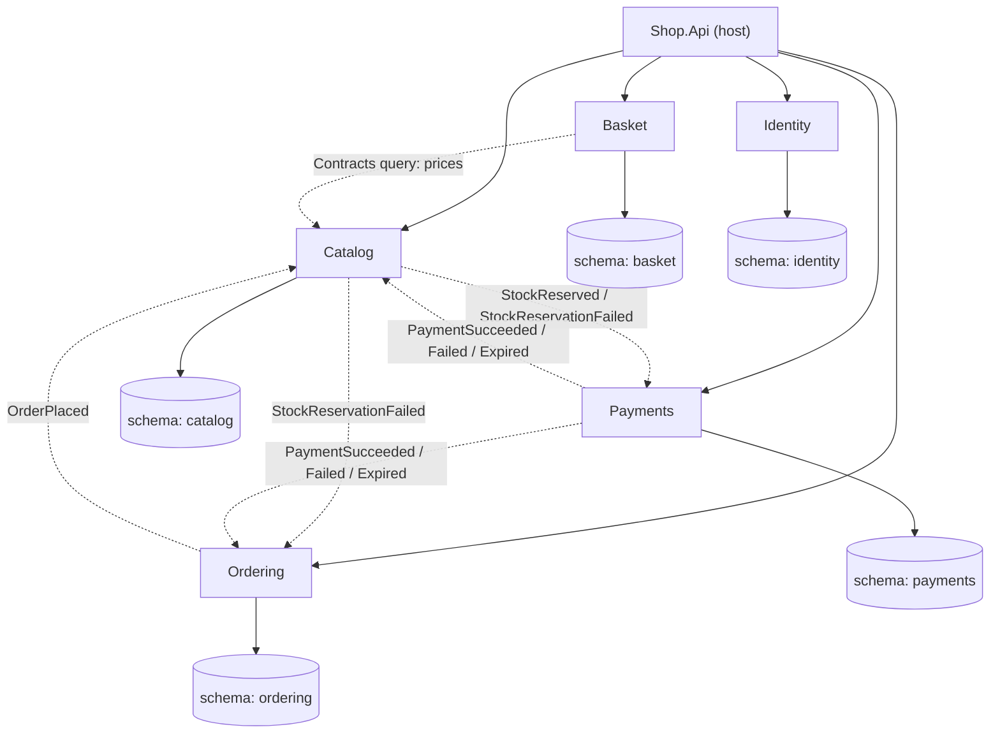

# VoltLane

A production-style e-commerce backend and storefront: a .NET 10 modular monolith with an Angular
front end, with a CI/CD pipeline that deploys to a single server.

[](https://github.com/huseyinsertac/net-ecommerce/actions/workflows/ci.yml)

**Live demo:** [204.168.194.99.sslip.io](https://204.168.194.99.sslip.io) · [API reference](https://204.168.194.99.sslip.io/scalar) · [health](https://204.168.194.99.sslip.io/health/ready)

## Demo accounts

No credentials are needed. On the home page:

- **Try as customer** creates a private, temporary account just for you.
- **Try as admin** signs into a shared admin account. Admin tools are coming soon (Plan 5), and
  the shared admin cannot use the cart.

Normal registration and sign-in also work. Screenshots: coming soon (Plan 5).

## Features

- **Catalog:** category tree with per-category spec schemas; products with option axes (colour,
  storage, ...), variants and stock.
- **Search and filters:** PostgreSQL full-text search with spec, price and brand filters and
  facet counts, served by a Dapper read side.
- **API contract:** OpenAPI snapshot checked into the repo, TypeScript types generated from it,
  and a CI drift guard that fails if they diverge.
- **Seeded data:** 77 products under fictional brands, with Unsplash photos credited in
  [CREDITS.md](web/shop-web/public/images/CREDITS.md).
- **Storefront:** home page, filterable product listing (filters live in the URL), product
  detail with a variant picker and gallery.
- **Accounts:** register, sign in, or use a one-click demo account. Short-lived JWT access tokens
  (15 minutes, kept in memory only) plus rotating refresh tokens in an HttpOnly, SameSite=Strict
  cookie. Reuse of a refresh token revokes its whole token family, with a 30 second single-use
  grace period so concurrent tabs do not log each other out.
- **API hardening:** per-IP rate limits, and a required `X-Requested-With` header on API writes.
- **Cart:** works for anonymous and signed-in users, with live prices and stock flags, and is
  merged into your account when you sign in.

Not built yet: checkout and payments (Plan 4).

### Identity design

Own user model with JWT access tokens and a rotating refresh cookie rather than ASP.NET Identity;
the trade-offs (token pruning, CSRF header, rate limits) are in
[ADR-0007](docs/adr/0007-identity-own-user-model-jwt-refresh-cookie.md).

### Catalog design

Search is Postgres full-text plus JSONB specs queried through a SQL read side, rather than an
external search engine. The reasoning is in
[ADR-0006](docs/adr/0006-catalog-search-postgres-fts-jsonb-sql-read-side.md).

## Tech stack

- **Backend:** .NET 10, ASP.NET Core, EF Core, Npgsql
- **Database:** PostgreSQL 18, one schema per module
- **Frontend:** Angular 22 with Angular Material
- **Infrastructure:** Docker, Caddy (automatic HTTPS), GitHub Actions, GHCR, single VPS
- **Testing:** Microsoft.Testing.Platform, Testcontainers, Vitest

## Architecture at a glance

- One deployable **modular monolith**: five business modules inside a single host (`Shop.Api`).
- Each module owns its **own Postgres schema**; no cross-module table access or joins.
- Modules talk only through **Contracts** projects and **integration events**, never each
  other's internals. Architecture tests enforce this.
- Events are delivered reliably with a transactional **outbox** (publish) and **inbox**
  (idempotent consume).
- A small in-house dispatcher handles commands and queries instead of MediatR.



Dashed arrows are Contracts-only communication (integration events via outbox/inbox, plus one
Contracts query). The modules' business logic lands in Plans 2-4; the foundation and messaging
infrastructure exist now.

Decisions are recorded as ADRs:

- [0001 Modular monolith](docs/adr/0001-modular-monolith.md)
- [0002 Layer projects per module](docs/adr/0002-layer-projects-per-module.md)
- [0003 Schema per module](docs/adr/0003-schema-per-module.md)
- [0004 Outbox/inbox choreography](docs/adr/0004-outbox-inbox-choreography.md)
- [0005 Own dispatcher instead of MediatR](docs/adr/0005-own-dispatcher-instead-of-mediatr.md)
- [0006 Catalog search: Postgres FTS, JSONB specs, SQL read side](docs/adr/0006-catalog-search-postgres-fts-jsonb-sql-read-side.md)
- [0007 Identity: own user model, JWT and refresh cookie](docs/adr/0007-identity-own-user-model-jwt-refresh-cookie.md)

## Run locally

Requires Docker.

```bash
cd deploy
cp .env.example .env
docker compose up -d --build
```

Then open http://localhost:8080.

## Develop from source

```bash
docker compose -f deploy/docker-compose.yml up -d postgres   # PostgreSQL on localhost:5433
dotnet run --project src/Bootstrapper/Shop.Api               # API on http://localhost:5080
cd web/shop-web && npm ci && npx ng serve                    # UI on http://localhost:4200 (proxies /api)
```

(`deploy/.env` must exist first: `cp deploy/.env.example deploy/.env`.)

## Testing

```bash
dotnet test --solution VoltLane.slnx -c Release
cd web/shop-web && npm ci && npx ng test --no-watch
```

- **Unit tests** for domain logic and building blocks, including `Catalog.UnitTests`, `Identity.UnitTests` and
  `Basket.UnitTests`.
- **Architecture tests** that fail the build if a module reaches into another module's internals.
- **Integration tests** against a real PostgreSQL started by **Testcontainers** (no mocked
  database).
- Frontend unit tests run through the Angular test runner.
- **OpenAPI snapshot:** after an API change, regenerate the snapshot with
  `UPDATE_OPENAPI_SNAPSHOT=1 dotnet test --solution VoltLane.slnx`, then run
  `npm run api:types` in `web/shop-web`. CI fails if either is stale.

`TreatWarningsAsErrors` is on by design, including NuGet audit warnings: a newly published
vulnerability advisory for a dependency fails CI until it is addressed.

## CI/CD

Pull requests and pushes to `main` run backend and frontend CI, and build both Docker images
(without pushing) so a broken Dockerfile fails before merge. Every merge to `main` is tested,
built and deployed automatically: after CI succeeds, the Deploy workflow builds and pushes images
to GHCR, updates the server over SSH, and fails unless `/health/ready` reports `Healthy`.
Server setup: [deploy/SERVER_SETUP.md](deploy/SERVER_SETUP.md).

## Roadmap

- [x] **Plan 1:** Foundation and walking skeleton (modules, CI/CD, first deploy)
- [x] **Plan 2:** Catalog and storefront
- [x] **Plan 3:** Identity and Basket
- [ ] **Plan 4:** Ordering and Payments (Stripe test mode)
- [ ] **Plan 5:** Admin, nightly demo reset, rate limiting, polish

## License

[MIT](LICENSE)
