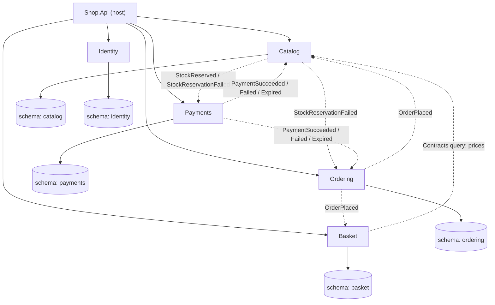
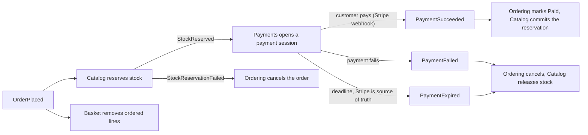

# VoltLane

A production-style e-commerce backend and storefront: a .NET 10 modular monolith with an Angular
front end, with a CI/CD pipeline that deploys to a single server.

[](https://github.com/huseyinsertac/net-ecommerce/actions/workflows/ci.yml)

**Live demo:** [huseyinsertacnetecommerce.duckdns.org](https://huseyinsertacnetecommerce.duckdns.org) · [API reference](https://huseyinsertacnetecommerce.duckdns.org/scalar) · [health](https://huseyinsertacnetecommerce.duckdns.org/health/ready)

## Demo accounts

No credentials are needed. On the home page:

- **Try as customer** creates a private, temporary account just for you.
- **Try as admin** signs into a shared admin account. Admin tools are coming soon (Plan 5), and
  the shared admin cannot use the cart.

Each demo customer starts with three historical orders, so the order history is not empty.
To try checkout, add something to the cart and place the order. On Stripe's page, pay with the
test card `4242 4242 4242 4242`, any future expiry date and any CVC. No real money moves: the
site only accepts Stripe test-mode keys.

Normal registration and sign-in also work. Screenshots: coming soon (Plan 5).

## Features

- **Catalog:** category tree with per-category spec schemas; products with option axes (colour,
  storage, ...), variants and stock.
- **Search and filters:** PostgreSQL full-text search with spec, price and brand filters and
  facet counts, served by a Dapper read side.
- **API contract:** OpenAPI snapshot checked into the repo, TypeScript types generated from it,
  and a CI drift guard that fails if they diverge.
- **Seeded data:** 77 products under fictional brands, with Unsplash photos credited in
  [CREDITS.md](web/shop-web/public/images/CREDITS.md).
- **Storefront:** home page, filterable product listing (filters live in the URL), product
  detail with a variant picker and gallery.
- **Accounts:** register, sign in, or use a one-click demo account. Short-lived JWT access tokens
  (15 minutes, kept in memory only) plus rotating refresh tokens in an HttpOnly, SameSite=Strict
  cookie. Reuse of a refresh token revokes its whole token family, with a 30 second single-use
  grace period so concurrent tabs do not log each other out.
- **API hardening:** per-IP rate limits, and a required `X-Requested-With` header on API writes.
- **Cart:** works for anonymous and signed-in users, with live prices and stock flags, and is
  merged into your account when you sign in.
- **Checkout and payments:** place an order from the cart, then pay on Stripe's hosted Checkout page
  (test mode only). Stock is reserved first, the order moves through a status timeline to `Paid`
  (or is cancelled and the stock released), and the order history lists every order.

Not built yet: admin tools, the nightly demo reset and screenshots (Plan 5), and refunds (Milestone 2).

### Identity design

Own user model with JWT access tokens and a rotating refresh cookie rather than ASP.NET Identity;
the trade-offs (token pruning, CSRF header, rate limits) are in
[ADR-0007](docs/adr/0007-identity-own-user-model-jwt-refresh-cookie.md).

### Catalog design

Search is Postgres full-text plus JSONB specs queried through a SQL read side, rather than an
external search engine. The reasoning is in
[ADR-0006](docs/adr/0006-catalog-search-postgres-fts-jsonb-sql-read-side.md).

## Tech stack

- **Backend:** .NET 10, ASP.NET Core, EF Core, Npgsql
- **Database:** PostgreSQL 18, one schema per module
- **Frontend:** Angular 22 with Angular Material
- **Infrastructure:** Docker, Caddy (automatic HTTPS), GitHub Actions, GHCR, single VPS
- **Testing:** Microsoft.Testing.Platform, Testcontainers, Vitest

## Architecture at a glance

- One deployable **modular monolith**: five business modules inside a single host (`Shop.Api`).
- Each module owns its **own Postgres schema**; no cross-module table access or joins.
- Modules talk only through **Contracts** projects and **integration events**, never each
  other's internals. Architecture tests enforce this.
- Events are delivered reliably with a transactional **outbox** (publish) and **inbox**
  (idempotent consume).
- A small in-house dispatcher handles commands and queries instead of MediatR.



Dashed arrows are Contracts-only communication (integration events via outbox/inbox, plus one
Contracts query).

### Checkout flow

Checkout is choreographed with integration events; no module owns the whole flow
([ADR-0008](docs/adr/0008-payments-stripe-checkout-choreography.md)).



Decisions are recorded as ADRs:

- [0001 Modular monolith](docs/adr/0001-modular-monolith.md)
- [0002 Layer projects per module](docs/adr/0002-layer-projects-per-module.md)
- [0003 Schema per module](docs/adr/0003-schema-per-module.md)
- [0004 Outbox/inbox choreography](docs/adr/0004-outbox-inbox-choreography.md)
- [0005 Own dispatcher instead of MediatR](docs/adr/0005-own-dispatcher-instead-of-mediatr.md)
- [0006 Catalog search: Postgres FTS, JSONB specs, SQL read side](docs/adr/0006-catalog-search-postgres-fts-jsonb-sql-read-side.md)
- [0007 Identity: own user model, JWT and refresh cookie](docs/adr/0007-identity-own-user-model-jwt-refresh-cookie.md)
- [0008 Payments: Stripe Checkout, webhooks and the fake gateway](docs/adr/0008-payments-stripe-checkout-choreography.md)

## Run locally

Requires Docker.

```bash
cd deploy
cp .env.example .env
docker compose up -d --build
```

Then open http://localhost:8080.

The local stack uses the **simulated payment page** (the Fake provider), so checkout works with no
Stripe account: you choose whether the payment succeeds or fails. The Fake provider is allowed here
through `Payments__AllowFakeProviderInProduction`, and `docker-compose.prod.yml` never sets it.

To exercise real Stripe webhooks locally, run the API with `Payments__Provider=Stripe`, a test-mode
`Stripe__SecretKey` (`sk_test_...`) and the signing secret the CLI prints as `Stripe__WebhookSecret`
(`whsec_...`) in its environment, then forward events:

```bash
stripe listen --forward-to localhost:8080/api/payments/stripe/webhook
```

## Develop from source

```bash
docker compose -f deploy/docker-compose.yml up -d postgres   # PostgreSQL on localhost:5433
dotnet run --project src/Bootstrapper/Shop.Api               # API on http://localhost:5080
cd web/shop-web && npm ci && npx ng serve                    # UI on http://localhost:4200 (proxies /api)
```

(`deploy/.env` must exist first: `cp deploy/.env.example deploy/.env`.)

## Testing

```bash
dotnet test --solution VoltLane.slnx -c Release
cd web/shop-web && npm ci && npx ng test --no-watch
```

- **Unit tests** for domain logic and building blocks, including `Catalog.UnitTests`, `Identity.UnitTests` and
  `Basket.UnitTests`.
- **Architecture tests** that fail the build if a module reaches into another module's internals.
- **Integration tests** against a real PostgreSQL started by **Testcontainers** (no mocked
  database).
- Frontend unit tests run through the Angular test runner.
- **OpenAPI snapshot:** after an API change, regenerate the snapshot with
  `UPDATE_OPENAPI_SNAPSHOT=1 dotnet test --solution VoltLane.slnx`, then run
  `npm run api:types` in `web/shop-web`. CI fails if either is stale.

`TreatWarningsAsErrors` is on by design, including NuGet audit warnings: a newly published
vulnerability advisory for a dependency fails CI until it is addressed.

## CI/CD

Pull requests and pushes to `main` run backend and frontend CI, and build both Docker images
(without pushing) so a broken Dockerfile fails before merge. Every merge to `main` is tested,
built and deployed automatically: after CI succeeds, the Deploy workflow builds and pushes images
to GHCR, updates the server over SSH, and fails unless `/health/ready` reports `Healthy`.
Server setup: [deploy/SERVER_SETUP.md](deploy/SERVER_SETUP.md).

## Roadmap

- [x] **Plan 1:** Foundation and walking skeleton (modules, CI/CD, first deploy)
- [x] **Plan 2:** Catalog and storefront
- [x] **Plan 3:** Identity and Basket
- [x] **Plan 4:** Ordering and Payments (Stripe test mode)
- [ ] **Plan 5:** Admin, nightly demo reset, rate limiting, polish

## License

[MIT](LICENSE)
