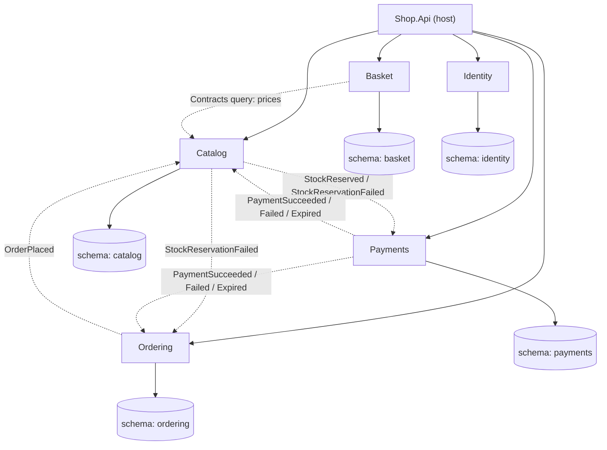

# VoltLane

A production-style e-commerce backend and storefront: a .NET 10 modular monolith with an Angular
front end, with a CI/CD pipeline that deploys to a single server.

[](https://github.com/OWNER/REPO/actions/workflows/ci.yml)

**Live demo:** https://YOUR-DOMAIN (API reference at `/scalar`, health at `/health/ready`)

Demo credentials and screenshots: coming soon (Plan 3/5).

## Tech stack

- **Backend:** .NET 10, ASP.NET Core, EF Core, Npgsql
- **Database:** PostgreSQL 18, one schema per module
- **Frontend:** Angular 22 with Angular Material
- **Infrastructure:** Docker, Caddy (automatic HTTPS), GitHub Actions, GHCR, single VPS
- **Testing:** Microsoft.Testing.Platform, Testcontainers, Vitest

## Architecture at a glance

- One deployable **modular monolith**: five business modules inside a single host (`Shop.Api`).
- Each module owns its **own Postgres schema**; no cross-module table access or joins.
- Modules talk only through **Contracts** projects and **integration events**, never each
  other's internals. Architecture tests enforce this.
- Events are delivered reliably with a transactional **outbox** (publish) and **inbox**
  (idempotent consume).
- A small in-house dispatcher handles commands and queries instead of MediatR.



Dashed arrows are Contracts-only communication (integration events via outbox/inbox, plus one
Contracts query). The modules' business logic lands in Plans 2-4; the foundation and messaging
infrastructure exist now.

Decisions are recorded as ADRs:

- [0001 Modular monolith](docs/adr/0001-modular-monolith.md)
- [0002 Layer projects per module](docs/adr/0002-layer-projects-per-module.md)
- [0003 Schema per module](docs/adr/0003-schema-per-module.md)
- [0004 Outbox/inbox choreography](docs/adr/0004-outbox-inbox-choreography.md)
- [0005 Own dispatcher instead of MediatR](docs/adr/0005-own-dispatcher-instead-of-mediatr.md)

## Run locally

Requires Docker.

```bash
cd deploy
cp .env.example .env
docker compose up -d --build
```

Then open http://localhost:8080.

## Testing

```bash
dotnet test --solution VoltLane.slnx -c Release
cd web/shop-web && npm ci && npx ng test --no-watch
```

- **Unit tests** for domain logic and building blocks.
- **Architecture tests** that fail the build if a module reaches into another module's internals.
- **Integration tests** against a real PostgreSQL started by **Testcontainers** (no mocked
  database).
- Frontend unit tests run through the Angular test runner.

## CI/CD

Pull requests and pushes to `main` run backend and frontend CI. Every merge to `main` is tested,
built and deployed automatically: after CI succeeds, the Deploy workflow builds and pushes images to GHCR, updates the server over SSH, and fails unless
`/health/ready` reports `Healthy`. Server setup: [deploy/SERVER_SETUP.md](deploy/SERVER_SETUP.md).

## Roadmap

- [ ] **Plan 1:** Foundation and walking skeleton (modules, CI/CD, first deploy) - in progress
- [ ] **Plan 2:** Catalog and storefront
- [ ] **Plan 3:** Identity and Basket
- [ ] **Plan 4:** Ordering and Payments (Stripe test mode)
- [ ] **Plan 5:** Admin, nightly demo reset, rate limiting, polish
